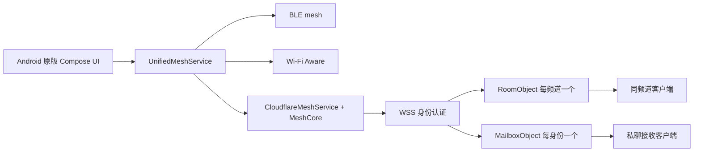

# 架构

UI 继续使用 MeshService。UnifiedMeshService 优先使用已建立的本地会话，随后选择在线会话；频道消息使用自定义封装，签名后把同一个逻辑包发送到本地与在线传输，避免双重消息。

私聊选择本地传输时，还核对蓝牙权限、蓝牙开关和 Wi-Fi 开关。旧的对端记录或 Noise 会话不代表无线通道仍可用；关闭本地无线后，可用的在线会话继续通过身份邮箱发送。

在线私聊文字在运行中的客户端暂存至收到目标对端的加密送达 / 已读回执：未确认时每 10 秒尝试重新加密发送，最多暂存 100 条，5 分钟仍未确认则标记失败。断网期间等待重连，停止在线服务会清空该内存重试状态。它不是跨进程的持久发件箱；已保存的聊天记录仍在加密数据库中。接收端先完成私聊入库才发加密送达回执；重复投递只在数据库中的发送身份、正文和类型匹配时补发回执，不再次添加消息或增加未读。存储失败与 panic 期间不发假回执。

CloudflareMeshService 使用原版 MeshCore 的 Noise、签名、回执、验证和分片接收。它关闭跨传输桥接和本地拓扑公告，按频道建立 WebSocket，不成为公共网关。近期文本同步为每个频道单独建立 gossip 缓存与过滤器，不跨频道分享缓存。

Worker 入口只验证路由、升级请求并选择对象。RoomObject 负责认证、创建者元数据和同频道广播；MailboxObject 负责身份邮箱、定向转发和有限密文恢复。对象使用 WebSocket 休眠、socket attachments、SQLite 和有数据才安排的清理 alarm。

应用显示频道在线、连接中、离线和密码状态。服务端接受、客户端传输收到、原版加密送达回执与已读状态有不同含义，不能互相替代。

0.2.4 将接收锁与发送队列锁分离，并把私聊重试的外部回调移到锁外。共享收包按发送者串行、有界等待，满载立即拒绝；在线邮箱只在成功入队后发传输确认，临时过载退避重连。房间成员和邮箱近期活动分别维护，避免退出房间误删仍可私聊的对端。具体瞬时预算与本地无线过载边界见 [整体优化](OPTIMIZATION.md)。

私聊数据库的单会话未读统计限定查询范围，重复 ID 必须核对消息内容、身份与会话关联。历史载入、写入和撤销绑定同一生命周期，旧任务不得越过 clear / panic 后恢复内容。图片在后台按尺寸采样，异步准备冻结目的会话并管理临时文件所有权。

## 生命周期与密码状态

RelayConnection 为每次连接使用独立 generation；失败时立即废弃旧 generation，包括重连退避期间，旧 socket 的消息与关闭回调不能恢复连接或修改新连接。认证必须按 challenge → auth → ready 顺序完成；30 秒仍未就绪时取消连接并进入带随机扰动的指数退避，最长基础等待 60 秒。停止服务会取消超时、重试和连接。

昵称公告仍是原版签名身份包。频道向同频道连接发送；没有共用就绪频道的已知在线对端通过邮箱接收同一公告。目标来自当前传输维护的 peer，不从持久联系人或历史聊天枚举；停止后不再发送。未读和会话名称共用消息模型的身份判断，本机身份在服务启动或 panic 重建后更新。

频道密钥状态集中在 TopicPayload。派生发生在后台；每个频道的操作有独立令牌，退出只废弃该频道的任务，panic 废弃所有任务。密码变更先暂存新密钥，收到 protected 或重连元数据中的对应摘要后再切换。密钥与元数据的读写使用同一同步边界；密码学计算使用快照，解密完成后再核对当前摘要，避免持锁处理大附件或返回失效密钥的内容。

服务器认证失败的 socket 不再参与后续处理；异步生成挑战密钥时预留连接名额，防止并发升级越过容量限制。二进制包固定上限为 65536 字节，与 Android 一致；增加 JSON 帧容量不会扩大客户端包上限。

## 可扩展方向

1. 先完成双机与大陆网络验收，确认前台 / 后台 / 长断网恢复。
2. 对热点频道实际测量单对象消息数、扇出、CPU 和每日额度。初始容量值可以调整；热点分片需增加协议中的订阅和成员一致性，不直接扩大计数器。
3. 若需要大附件，在独立功能开关下加入客户端加密对象存储、上传授权、过期和下载预算；R2 不属于默认免费保证。
4. 若需要推送，再明确 Google 服务覆盖、厂商限制、隐私与离线身份关联。当前只用前台服务与连接恢复。
5. 若需要更强的群组成员管理和密钥轮换，应设计独立版本的成员协议，不能把共享密码换成一个服务器访问令牌就声称具备群组前向保密。
6. 协议升级使用版本与黄金向量；DO 存储迁移保留已有标签；未来更换中继通过传输接口接入。

这些扩展不改变当前 Android 原版功能的保留目标，但需要各自的性能与安全验收。上线之前不把免费额度当作服务规模承诺。
